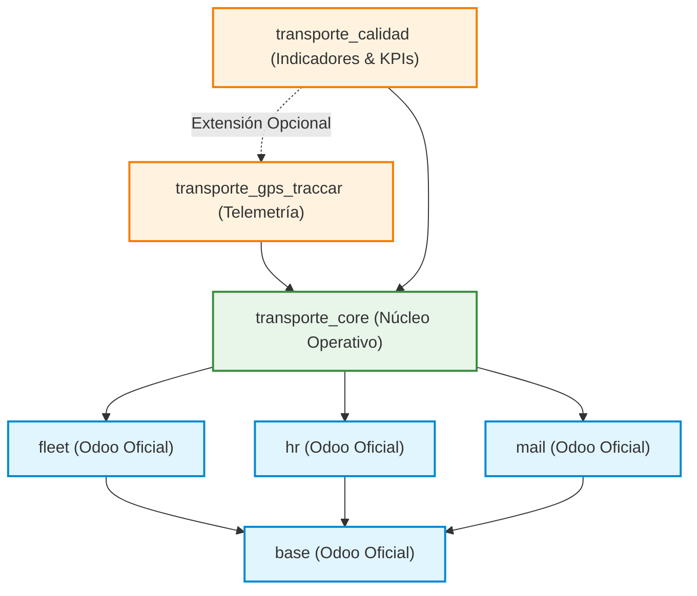
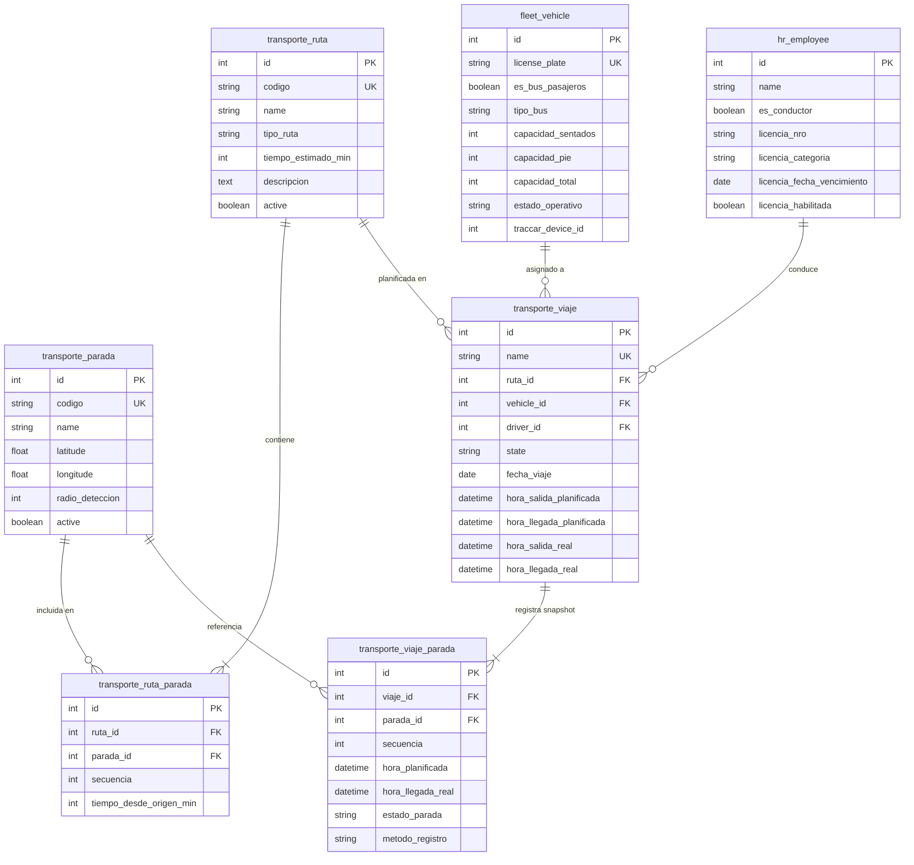

# Documento de Arquitectura de Software y Modelo de Datos
## Sistema de Gestión, Monitoreo y Calidad del Transporte en Buses (SGM-TB)

**Versión del Documento:** 1.0  
**Fecha:** Noviembre 2026  
**Ámbito:** Arquitectura modular desacoplada en Odoo 16 Community  

---

## 1. Principios de Diseño Arquitectónico

El sistema **SGM-TB** está concebido bajo una arquitectura en capas estrictamente desacoplada, orientada a evitar dependencias circulares, garantizar la operatividad manual en ausencia de telemetría y permitir la evolución concurrente de múltiples desarrolladores.

### Principios Fundamentales:
1. **Unidireccionalidad de Dependencias:** Los módulos superiores (`transporte_gps_traccar` y `transporte_calidad`) conocen y extienden al módulo base (`transporte_core`), pero `transporte_core` **desconoce por completo** a los módulos superiores.
2. **Operatividad Manual Nativa:** El sistema es 100% funcional sin conexión GPS ni Traccar. Toda parada y viaje puede gestionarse de forma manual.
3. **Extensión No Invasiva (`_inherit`):** La relación con modelos de Odoo (`fleet.vehicle`, `hr.employee`) y la incorporación de campos telemáticos o de calidad se realiza exclusivamente mediante herencia de Odoo, preservando la integridad del esquema original.
4. **Instantáneas Inmutables de Recorridos:** Las paradas de un viaje (`transporte.viaje.parada`) se congelan al programar el despacho, protegiendo el histórico ante futuras modificaciones de la ruta.

---

## 2. Diagrama de Arquitectura Modular y Dependencias

---

## 3. Descripción de Módulos

### 3.1. `transporte_core` (Núcleo Operativo — Fase 1)
- **Propósito:** Gestión fundamental de la infraestructura física y operacional del transporte público.
- **Modelos Principales:**
  - `transporte.parada`: Catálogo maestro de paradas georreferenciadas (código, nombre, lat/lon, radio de detección en metros).
  - `transporte.ruta`: Trazados de líneas de bus (tipo: urbana, troncal, alimentadora, interurbana; tiempo estimado).
  - `transporte.ruta.parada`: Tabla intermedia de orden correlativo de paradas y tiempos teóricos acumulados desde origen.
  - `fleet.vehicle` (Extensión): Capacidades de pasajeros (sentados, de pie, total), tipología de bus y estado operativo (`disponible`, `en_servicio`, `mantenimiento`, `fuera_servicio`).
  - `hr.employee` (Extensión): Registro de choferes, número de licencia, categoría y cálculo dinámico de habilitación (`licencia_habilitada`).
  - `transporte.viaje`: Despacho central con máquina de estados (`draft`, `scheduled`, `in_progress`, `completed`, `cancelled`), prevención de colisiones de horario y sincronización de flota.
  - `transporte.viaje.parada`: Snapshot inmutable de las paradas programadas con estampa de arribo real y estado (`pendiente`, `atendida`, `omitida`).

---

### 3.2. `transporte_gps_traccar` (Telemetría y Monitoreo — Fase 2)
- **Propósito:** Ingesta telemática desde el servidor Traccar, geocercas dinámicas y automatización de arribos.
- **Modelos y Extensiones:**
  - `fleet.vehicle` (Extensión `_inherit`): Incorpora `traccar_device_id`, fecha de última posición telemática y velocidad actual.
  - `transporte.gps.log`: Registro cronológico de tramas telemáticas (timestamp, lat, lon, speed, attributes).
  - Controlador Web / Webhook: Endpoint `/api/v1/traccar/webhook` protegido con validación de Token Bearer y descarte de posiciones duplicadas o ruido GPS.
  - Servicio de Geocercas: Evaluación Haversine contra el radio de `transporte.parada` para mutar automáticamente `transporte.viaje.parada.hora_llegada_real` y conmutar `metodo_registro = 'gps'`.

---

### 3.3. `transporte_calidad` (Calidad de Servicio y Tableros — Fase 3)
- **Propósito:** Medición objetiva de estándares de servicio, registro de incidencias y tableros de control directivo.
- **Modelos y Métricas:**
  - `transporte.incidencia`: Reportes de eventos anómalos clasificados por tipo (falla mecánica, bloqueo de vía, retraso severo, queja de usuario) y severidad.
  - Motor de KPIs:
    - **OTP (On-Time Performance):** Porcentaje de arribos dentro de una ventana de tolerancia $[-2, +5]$ minutos frente al horario estimado.
    - **Cumplimiento de Rutas:** Relación porcentual entre paradas atendidas vs. paradas totales programadas.
    - **Disponibilidad de Flota:** Porcentaje de buses aptos frente al parque total de vehículos de pasajeros.
    - **Tasa de Incidencias:** Cantidad de incidentes reportados por cada 100 viajes despachados.
  - Vistas Dashboard: Gráficos de barras, líneas temporales y tablas pivot sin requerir el módulo Enterprise.

---

## 4. Diagrama Entidad-Relación (ERD Conceptual)

---

## 5. Esquema de Seguridad y Roles (RBAC)

El sistema define dos grupos de usuarios en `security/transporte_security.xml`:

1. **Usuario Operativo (`group_transporte_user`):**
   - Acceso de lectura a rutas, paradas, buses y conductores.
   - Acceso de consulta a viajes y capacidad de ejecutar el botón *"Registrar Llegada Manual"* sobre paradas del viaje.
2. **Administrador de Transporte (`group_transporte_manager`):**
   - Permisos CRUD completos sobre todo el catálogo de rutas, paradas, configuración de flota, choferes y viajes.
   - Capacidad de programar, cancelar o restablecer despachos.
