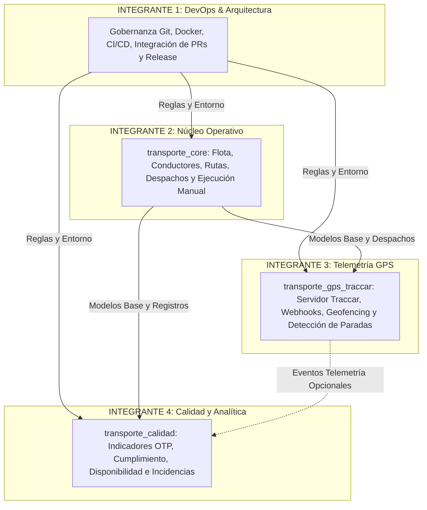

# Matriz de Distribución del Trabajo y Asignación de Roles
## Sistema de Gestión, Monitoreo y Calidad del Transporte en Buses (SGM-TB)

**Versión del Documento:** 1.0  
**Fecha:** Noviembre 2026  
**Equipo de Proyecto:** 4 Desarrolladores  

---

## 1. Organización del Equipo y Principio de Responsabilidad Única

Para evitar duplicidad de esfuerzos, conflictos en repositorios y dependencias cruzadas en base de datos, el trabajo se divide en **cuatro roles complementarios** con fronteras de responsabilidad claramente delimitadas:

---

## 2. Detalle de Responsabilidades y Entregables por Integrante

### INTEGRANTE 1 — Coordinación Técnica, DevOps e Integración
- **Misión:** Garantizar la estabilidad del entorno contenerizado, la gobernanza del repositorio Git, la compatibilidad entre módulos y la correcta integración de Pull Requests.
- **Responsabilidades Específicas:**
  1. Administrar la estructura del repositorio GitHub y las reglas de protección de ramas (`main` y `develop`).
  2. Mantener la configuración de Docker Compose, variables de entorno seguras (`.env.example`) y archivos de configuración de Odoo/PostgreSQL.
  3. Establecer y supervisar el cumplimiento del flujo de Git y revisión de Pull Requests.
  4. Revisar la seguridad de permisos (RBAC, `ir.model.access.csv`, `record rules`).
  5. Diseñar y ejecutar las pruebas de regresión e integración general del sistema.
  6. Resolver colisiones estructurales o conflictos de base de datos durante la integración de ramas.
- **Entregables Principales:**
  - Guías de instalación, Git y arquitectura del proyecto.
  - Entornos Docker y scripts de verificación reproducibles.
  - Bitácora consolidada de desarrollo (`docs/BITACORA_DESARROLLO.md`).
  - Releases y etiquetado de versiones estables (`v1.0.0`, etc.).
- **Rama de Trabajo:** `feature/integracion-devops`.
- **Bitácora Individual:** `docs/bitacoras/integrante_1.md`.

---

### INTEGRANTE 2 — Operaciones de Buses, Conductores y Despachos
- **Misión:** Mantener y evolucionar la lógica operativa central del sistema de transporte dentro de `transporte_core`, optimizando la experiencia de usuario y la solidez de las reglas de negocio de la flota.
- **Responsabilidades Específicas:**
  1. Administrar y refactorizar los modelos de rutas (`transporte.ruta`), paradas (`transporte.parada`) y secuencias (`transporte.ruta.parada`).
  2. Garantizar la disponibilidad operativa y validaciones de aforo de buses sobre `fleet.vehicle`.
  3. Supervisar la gestión de licencias de conducir y su vigencia sobre `hr.employee`.
  4. Mejorar la planificación de horarios y el motor de detección de solapamiento de viajes (`_check_conflictos_horarios`).
  5. Mantener y extender la máquina de estados de los viajes (`transporte.viaje` y `transporte.viaje.parada`).
  6. Ampliar los conjuntos de datos de prueba (DEMO) y asegurar la cobertura de pruebas de despacho.
- **Entregables Principales:**
  - Mejoras y optimizaciones funcionales sobre `transporte_core`.
  - Vistas refinadas de despachos (Formulario, Lista, Kanban, Calendario).
  - Casos de prueba unitarios para cada nueva regla de negocio.
  - Documentación de políticas de despacho de buses.
- **Rama de Trabajo:** `feature/operaciones-mejoras`.
- **Bitácora Individual:** `docs/bitacoras/integrante_2.md`.

---

### INTEGRANTE 3 — Telemática GPS e Integración con Traccar
- **Misión:** Desarrollar de manera desacoplada el módulo `transporte_gps_traccar`, implementando la ingesta segura y eficiente de datos telemáticos sin alterar la independencia de `transporte_core`.
- **Responsabilidades Específicas (Fase 2):**
  1. Crear la estructura del addon `transporte_gps_traccar`.
  2. Configurar la comunicación con el servidor Traccar (API REST y Webhooks).
  3. Vincular dispositivos GPS (`traccar_device_id`) con los buses de `fleet.vehicle` mediante herencia `_inherit`.
  4. Implementar endpoint seguro (`/api/v1/traccar/position` o webhook) con validación de tokens Bearer.
  5. Procesar eventos de geocercas y proximidad para registrar automáticamente el arribo a paradas (`metodo_registro = 'gps'`).
  6. Manejar resiliencia telemática: filtrado de tramas duplicadas, pérdida de señal y reconexiones.
- **Entregables Principales:**
  - Addon independiente `addons/transporte_gps_traccar`.
  - Documentación de integración con Traccar y configuración de dispositivos.
  - Suite de pruebas con simulación de tramas GPS y coordenadas dinámicas.
- **Rama de Trabajo:** `feature/gps-traccar`.
- **Bitácora Individual:** `docs/bitacoras/integrante_3.md`.

---

### INTEGRANTE 4 — Calidad del Servicio y Tableros Analíticos
- **Misión:** Desarrollar el módulo analítico `transporte_calidad` para la evaluación objetiva del servicio de transporte en buses, operable tanto con datos manuales como telemáticos.
- **Responsabilidades Específicas (Fase 3):**
  1. Crear la estructura del addon `transporte_calidad`.
  2. Implementar el modelo de incidencias operativas (`transporte.incidencia`) con tipificación, severidad y estado.
  3. Calcular indicadores clave de rendimiento (KPIs):
     - Puntualidad en Paradas (*On-Time Performance* - OTP).
     - Cumplimiento de Recorridos (Paradas atendidas vs. programadas).
     - Disponibilidad de Flota (Buses operativos vs. flota total).
     - Tasa de Incidencias Operativas (por cada 100 viajes despachados).
  4. Garantizar que los cálculos funcionen con viajes registrados manualmente desde `transporte_core`, sin obligar a que Traccar esté desplegado.
  5. Diseñar vistas tipo Dashboard / Tableros de Calidad con gráficos y métricas ejecutivas.
- **Entregables Principales:**
  - Addon independiente `addons/transporte_calidad`.
  - Reportes de calidad de servicio y vistas pivot/gráfico.
  - Pruebas automatizadas de fórmulas de cálculo de indicadores y casos borde (viajes cancelados o incompletos).
- **Rama de Trabajo:** `feature/calidad-kpis`.
- **Bitácora Individual:** `docs/bitacoras/integrante_4.md`.

---

## 3. Matriz de Dependencias e Interacción

| Módulo / Capa | Depende De | ¿Quién lo Modifica? | ¿Quién lo Consume? |
| :--- | :--- | :--- | :--- |
| `transporte_core` | `fleet`, `hr`, `mail`, `base` | Integrante 2 (con soporte de Integrante 1) | Integrante 3 e Integrante 4 |
| `transporte_gps_traccar` | `transporte_core` | Integrante 3 | Integrante 4 (para enriquecer métricas con GPS) |
| `transporte_calidad` | `transporte_core` (opcionalmente `transporte_gps_traccar`) | Integrante 4 | Todo el sistema (Reportes e Indicadores) |

> [!IMPORTANT]
> **Independencia Arquitectónica Fundamental:**  
> `transporte_core` **NUNCA** debe importar ni declarar dependencias hacia `transporte_gps_traccar` ni hacia `transporte_calidad`. El flujo de dependencia es estrictamente unidireccional.
