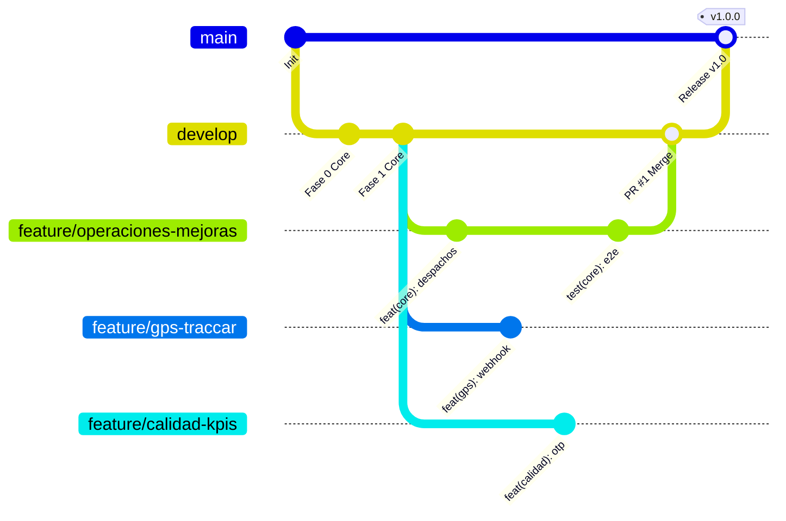

# Guía de Flujo de Trabajo en Git, Ramas y Pull Requests
## Sistema de Gestión, Monitoreo y Calidad del Transporte en Buses (SGM-TB)

**Versión del Documento:** 1.0  
**Fecha:** Noviembre 2026  
**Audiencia:** Equipo de desarrollo SGM-TB  

---

## 1. Filosofía y Estrategia de Ramificación (GitFlow Adaptado)

Para garantizar un desarrollo ordenado, libre de colisiones y con alta calidad de código entre los cuatro desarrolladores, se establece una variante estructurada de **GitFlow**.



---

## 2. Tipos de Ramas y Convenciones de Nomenclatura

| Rama / Prefijo | Propósito | Rama Origen | Rama Destino | Responsable |
| :--- | :--- | :--- | :--- | :--- |
| `main` | Código de producción, estable y auditado. Protegida contra commits directos. | N/A | N/A | Todos (Vía Release) |
| `develop` | Rama principal de integración continua. Refleja el estado consolidado de la versión en desarrollo. | `main` | `main` | Integrante 1 (DevOps) |
| `feature/integracion-devops` | Tareas de infraestructura, docker, empaquetado, scripts y gobernanza. | `develop` | `develop` | Integrante 1 |
| `feature/operaciones-mejoras` | Mejoras y mantenimiento del núcleo operativo (`transporte_core`). | `develop` | `develop` | Integrante 2 |
| `feature/gps-traccar` | Desarrollo del módulo telemático (`transporte_gps_traccar`). | `develop` | `develop` | Integrante 3 |
| `feature/calidad-kpis` | Desarrollo del módulo analítico (`transporte_calidad`). | `develop` | `develop` | Integrante 4 |
| `fix/<modulo>-<descripcion>` | Correcciones puntuales de anomalías o fallos en tests. | `develop` | `develop` | Quien reporte/asigne |

---

## 3. Procedimiento Obligatorio de Trabajo en 10 Pasos

Cada funcionalidad, refactorización o corrección debe seguir estrictamente este flujo secuencial:

### Paso 1: Sincronizar la rama `develop` local
Antes de comenzar cualquier trabajo, asegúrate de tener el código más reciente aprobado por el equipo:
```bash
git checkout develop
git pull origin develop
```

### Paso 2: Crear o conmutar a la rama de funcionalidad
Crea tu rama de trabajo a partir de `develop`:
```bash
git checkout -b feature/nombre-de-tu-tarea
```

### Paso 3: Desarrollar exclusivamente el alcance asignado
- Modifica únicamente los archivos de tu módulo o responsabilidad.
- No alteres archivos de configuración general (`docker-compose.yml`, `config/odoo.conf`) sin previa coordinación con el Integrante 1 (DevOps).

### Paso 4: Ejecutar pruebas automatizadas locales
Ningún cambio puede enviarse a revisión si rompe los tests del módulo o de módulos dependientes:
```bash
docker exec odoo16_web /entrypoint.sh odoo \
  -d sgmtb_dev_tu_nombre \
  -u transporte_core \
  --test-enable \
  --test-tags /transporte_core \
  --no-http \
  --stop-after-init
```

### Paso 5: Registrar la actividad en tu bitácora individual
Actualiza tu archivo personal en `docs/bitacoras/integrante_X.md` registrando la fecha, actividad, archivos tocados, resultado de pruebas y commit.

### Paso 6: Crear commits atómicos y convencionales
Sigue la convención **Conventional Commits**:
- `feat(modulo): descripción clara` $\rightarrow$ Nueva característica.
- `fix(modulo): descripción clara` $\rightarrow$ Corrección de bug.
- `test(modulo): descripción clara` $\rightarrow$ Agregado o refactorización de tests.
- `docs(modulo): descripción clara` $\rightarrow$ Documentación técnica o bitácoras.
- `refactor(modulo): descripción clara` $\rightarrow$ Mejora estructural sin cambio funcional.

```bash
git add addons/transporte_core/models/archivo.py docs/bitacoras/integrante_2.md
git commit -m "feat(core): add dynamic validation for bus capacity overload"
```

### Paso 7: Publicar la rama en el repositorio remoto
Publica tu rama en GitHub (únicamente cuando el repositorio remoto esté activo y autorizado):
```bash
git push -u origin feature/nombre-de-tu-tarea
```

### Paso 8: Abrir un Pull Request (PR) hacia `develop`
En la interfaz de GitHub:
- Base branch: `develop`.
- Compare branch: `feature/nombre-de-tu-tarea`.
- Completa la descripción del PR detallando:
  1. ¿Qué problema resuelve o qué funcionalidad implementa?
  2. ¿Qué modelos o vistas fueron alterados?
  3. Evidencia de pruebas locales ejecutadas (`0 failed, 0 errors`).

### Paso 9: Solicitar revisión cruzada (Code Review)
- Asigna al menos a otro compañero del equipo como Revisor (*Reviewer*).
- El revisor debe inspeccionar el código buscando dependencias circulares, violaciones de estándares de Odoo, seguridad y cobertura de pruebas.

### Paso 10: Fusión controlada hacia `develop`
Una vez obtenido el visto bueno (*Approved*) y comprobado que los tests pasan:
- El Integrante 1 o el autor fusiona el PR mediante merge commit no fast-forward (`--no-ff`).
- Se elimina la rama remota temporal para mantener el repositorio limpio.

---

## 4. Resolución de Conflictos de Código

Si al intentar fusionar `develop` en tu rama existen conflictos:

1. **Nunca resuelvas a ciegas:** Si el conflicto involucra lógica de otro compañero, coordina con él antes de decidir qué fragmento conservar.
2. **Procedimiento estándar:**
   ```bash
   git checkout feature/tu-rama
   git fetch origin
   git merge origin/develop
   ```
3. Revisa los archivos en conflicto marcados con `<<<<<<<`, `=======`, `>>>>>>>`.
4. Presta especial atención a:
   - `__manifest__.py`: Declaraciones en `'data'` o `'depends'`.
   - `ir.model.access.csv`: Filas de permisos.
   - `models/__init__.py`: Importaciones de nuevos modelos.
5. Tras resolver manualmente el conflicto, ejecuta la suite de tests:
   ```bash
   docker exec odoo16_web /entrypoint.sh odoo -d sgmtb_dev_tu_nombre -u transporte_core --test-enable --test-tags /transporte_core --no-http --stop-after-init
   ```
6. Si todo pasa satisfactoriamente, confirma la resolución:
   ```bash
   git add <archivos_resueltos>
   git commit -m "chore(merge): resolve conflict with develop"
   git push origin feature/tu-rama
   ```

---

## 5. Reglas de Oro para Todo el Equipo

> [!CAUTION]
> 1. **Prohibido Push Directo a `main` o `develop`:** Todo cambio ingresa obligatoriamente a través de un Pull Request revisado y probado.
> 2. **Prohibido `git push --force`:** Nunca utilices `--force` sobre ramas compartidas (`develop`, `main`).
> 3. **Prohibido Subir Credenciales:** Nunca incluyas tokens personales de GitHub, contraseñas reales ni archivos `.env`.
> 4. **No Ocultar Tests Rotos:** Si un test falla tras un cambio, corrígelo de raíz; nunca desactives una aserción para que el runner pase en verde.

