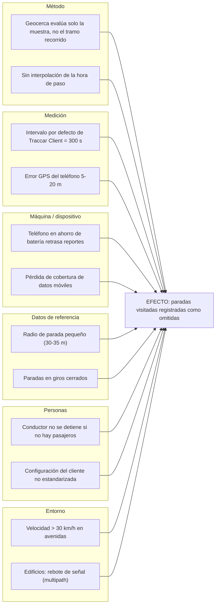

# Informe de Mejora Continua (Actividad 10)

## 1. Problema identificado

**D-01 — Paradas visitadas registradas como «omitidas».** Durante las pruebas del escenario
*muestreo disperso* (Traccar Client reportando cada 120 s), el sistema marcaba como omitidas paradas por las
que el bus sí pasó. Esto contamina tres indicadores: % de paradas cumplidas, % de cumplimiento de rutas y
% de detección correcta de incidencias, y genera incidencias falsas de *Parada omitida* y *Recorrido incompleto*.

Causa raíz técnica: la geocerca original (`transporte_gps_traccar`) solo marcaba la parada si **una muestra GPS**
caía dentro de su radio (30–50 m). Entre dos reportes el bus avanza `velocidad × intervalo` metros
(20 km/h × 120 s = 667 m), así que casi nunca hay una muestra dentro de un círculo de 35 m.

## 2. Ishikawa (causa–efecto)

Causas priorizadas (verificadas con datos en §4): **M1** (método por muestra), **D1/P2** (intervalo largo sin
estandarizar), **T2 + E1** (giro cerrado a alta velocidad, causa residual).

## 3. Pareto

### 3.1 Defectos del software encontrados durante el desarrollo y las pruebas

Puntuación = severidad (1–5) × alcance (1–5: proporción de recorridos/usuarios afectados).

| Defecto | Severidad | Alcance | Puntuación | % | % acumulado |
| :--- | :-: | :-: | :-: | :-: | :-: |
| D-01 Paradas visitadas marcadas omitidas (intervalo GPS largo) | 5 | 5 | 25 | 22,9 | 22,9 |
| D-07 Pruebas de navegador saltadas en silencio | 4 | 5 | 20 | 18,3 | 41,3 |
| D-05 Servidor sin ruta de addons (`odoo.conf` vacío) | 5 | 3 | 15 | 13,8 | 55,0 |
| D-02 Rol *Consulta* sin acceso a buses | 4 | 3 | 12 | 11,0 | 66,1 |
| D-08 Mapas dependientes del CDN (en blanco sin Internet) | 4 | 3 | 12 | 11,0 | 77,1 |
| D-03 Última posición podía ser simulada | 3 | 2 | 6 | 5,5 | 82,6 |
| D-09 Mapa de rutas con diseño roto | 3 | 2 | 6 | 5,5 | 88,1 |
| D-06 Pérdida de señal tratada como incumplimiento | 2 | 2 | 4 | 3,7 | 91,7 |
| D-10 `@api.depends` perdido en el nº de puntos del trazado | 2 | 2 | 4 | 3,7 | 95,4 |
| D-04 `registrar()` no serializable por RPC | 1 | 1 | 1 | 0,9 | 96,3 |
| Otros (avisos de formato, imports sin uso) | 1 | 4 | 4 | 3,7 | 100 |

D-01, D-07 y D-05 suman el ~55 % del impacto y, con D-02 y D-08, el ~77 %. Se priorizó **D-01** porque afecta
la exactitud de las métricas (PDCA, §4). D-07 —segundo en impacto— es un defecto del *proceso de pruebas*: daba
confianza falsa en la interfaz, por eso el script ahora falla si una prueba de navegador se salta.
D-02 a D-10 se corrigieron directamente (ver `docs/PLAN_PRUEBAS.md §5`).

### 3.2 Incidencias operativas (desde el sistema)
El dashboard muestra el Pareto en vivo. Con los 10 recorridos simulados: *Retraso en parada* 50 %,
*Parada omitida* 18 % (68 % acumulado), *Retraso en llegada* 9 % (77 %). Sirve para priorizar acciones
operativas: los retrasos en parada son la incidencia más frecuente.

## 4. Ciclo PDCA

### PLAN
- **Indicador:** % de paradas detectadas en recorridos donde el bus visitó todas las paradas; % de detección
  correcta de incidencias.
- **Línea base** (`scripts/medir_deteccion_paradas.py`, 60 recorridos por intervalo, 3 rutas DEMO, 20 km/h,
  bus que no se detiene = peor caso):
  - Intervalo por defecto (300 s): **38,9 %** de paradas detectadas, **100 %** de los viajes con falsa omisión.
  - Intervalo de 30 s: **77,8 %** detectadas, 66,7 % de los viajes con falsa omisión.
  - Plan de 10 escenarios × 6 días: detección correcta **90 %** (54/60; fallan todos los de muestreo disperso).
- **Meta:** 100 % de paradas detectadas y 0 % de falsas omisiones con la configuración estándar del sistema.
- **Acciones:** (1) cambiar el método de la geocerca (causa M1); (2) estandarizar el intervalo de Traccar Client (D1/P2).

### DO
1. `geo_utils.proyeccion_en_segmento` y `geo_utils.paso_por_radio`: además de la muestra actual, se evalúa la
   distancia de la parada al **tramo** entre la muestra anterior y la actual; si pasa por el radio se marca
   visitada con la **hora interpolada** del punto más cercano.
2. Protección: no se interpola a través de huecos > 360 s (eso es pérdida de señal, no un paso).
3. Modo configurable (`Ajustes ▸ Transporte GPS ▸ Detección de paradas`): *segmento* por defecto; *punto*
   reproduce el comportamiento anterior para poder medir.
4. Pruebas nuevas: 6 pytest de geometría, `test_geocerca_segmento_detecta_paso_entre_muestras`,
   `test_cp12_geocerca_punto_vs_segmento` (Odoo).

### CHECK (`docs/evidencias/pdca_deteccion_paradas.csv`)

| Intervalo | Antes (punto) | Después (segmento) | Viajes con falsa omisión antes → después |
| :--- | :-: | :-: | :-: |
| 10 s | 100 % | 100 % | 0 % → 0 % |
| 15 s | 91,1 % | **100 %** | 33,3 % → **0 %** |
| 30 s | 77,8 % | **100 %** | 66,7 % → **0 %** |
| 60 s | 72,2 % | 94,4 % | 100 % → 33,3 % |
| 120 s | 50,0 % | 61,1 % | 100 % → 66,7 % |
| 300 s (por defecto) | 38,9 % | 61,1 % | 100 % → 100 % |

- Detección correcta de incidencias (plan de 10 escenarios × 6 días): **90 % → 100 %** (54/60 → 60/60).
- Hallazgo: con intervalos ≥ 60 s la mejora **no basta**. En giros cerrados la cuerda entre dos muestras
  «corta la esquina» y pasa lejos de la parada; a 35 km/h el residuo aparece incluso con 10 s en la parada en giro
  de la ruta 202. La mejora de software reduce el problema, pero no elimina la causa de medición (D1).

### ACT (estandarización)
1. Geocerca por tramo como **valor por defecto** del sistema (ya desplegada en `transporte_universitario_gc`).
2. **Configuración estándar de Traccar Client: frecuencia 30 s** (o 15 s), distancia 0, precisión alta, sin
   ahorro de batería. Documentada en `docs/GUIA_CLOUDFLARE.md` y `docs/GUIA_TRACCAR.md`.
3. Paradas en giros cerrados de avenidas rápidas: aumentar su radio a 50 m.
4. Control: el indicador «Detección correcta de incidencias» y el filtro «Detección incorrecta» de viajes
   quedan en el dashboard para vigilar regresiones; `test_cp12` impide volver al comportamiento anterior.
5. Próximo ciclo: validar con recorridos reales (Traccar Client a 30 s) y comparar contra el resultado simulado.

## 5. Segundo ciclo PDCA — confiabilidad de las pruebas y mantenibilidad (20/11/2026)

Problema: los resultados de calidad **parecían** mejores de lo que eran. Las 4 pruebas de navegador se saltaban sin
avisar (D-07), los mapas fallaban sin Internet (D-08) y no se veía que el mapa de rutas estaba roto (D-09), porque
nadie miraba la interfaz renderizada. Además, la regla central `reglas.evaluar_viaje` tenía complejidad cognitiva 46
(máximo recomendado 15), lo que hacía arriesgado tocar las reglas de detección.

| Fase | Acción |
| :--- | :--- |
| **PLAN** | Causas: dependencia no verificada (`python3-websocket`), Odoo informa «0 failed» aunque salte pruebas, recursos de un CDN y una función que acumula 9 reglas. Meta: 0 pruebas de interfaz saltadas, mapas sin dependencias externas y ninguna regla de detección con complejidad > 15, sin cambiar resultados. |
| **DO** | Dependencia instalada; `ejecutar_pruebas.sh` trata una prueba saltada como fallo; capturas automatizadas de escritorio y móvil; Leaflet incluido en el módulo; `evaluar_viaje` dividida en una función por regla (`_regla_retraso_inicio`, `_regla_retraso_llegada`, `_regla_diferencia_tiempo`, `_regla_recorrido_incompleto`, `_reglas_gps`, `_veredicto`); `generar_recorrido` dividida en `_preparar_nodos`, `_posicion`, `_hueco_senal`, `_velocidad_kmh` e `_instantes`. Se añadió una prueba de integración **en vivo** contra un Traccar real. |
| **CHECK** | Ver tabla. Mismos resultados de detección (74 pytest, 95 Odoo y 10/10 escenarios simulados correctos) antes y después del refactor; el simulador produce trazas idénticas byte a byte (huella SHA-256 sobre 72 combinaciones escenario × intervalo × semilla). |
| **ACT** | El script falla si una prueba de interfaz se salta; el paso 5 (Traccar en vivo) forma parte de la suite; SonarQube se ejecuta con `docs/CALIDAD_SOFTWARE.md §2`. Las funciones nuevas se escriben con complejidad ≤ 15. |

| Indicador | Antes | Después |
| :--- | :-: | :-: |
| Pruebas de interfaz realmente ejecutadas | 1 de 5 (4 saltadas) | **5 de 5** |
| Pruebas de integración contra Traccar real | 0 (solo mocks) | **2** (OsmAnd → Traccar → Odoo → exactitud 100 %) |
| Mapas que funcionan sin Internet | 0 de 3 | **3 de 3** (sin fondo de calles) |
| Complejidad cognitiva de `evaluar_viaje` / `generar_recorrido` | 46 / 31 | **≤ 15** (ya no las señala SonarQube) |
| Deuda técnica SonarQube | 399 min (1.ª pasada) | **312 min** |
| Bugs / vulnerabilidades SonarQube | 3 / 3 | **0 / 0** |

## 6. Tercer ciclo PDCA — usabilidad por *benchmarking* con Moovit (21/11/2026)

Problema: la retroalimentación del equipo sobre la interfaz fue «todo está muy abultado, mucha información, mala
repartición» y «se ve rígido y estático, como Odoo». Una persona que solo quiere saber **dónde va el bus y cuándo
llega** tenía que abrir el dashboard (12 indicadores) o el mapa GPS (sin horarios).

| Fase | Acción |
| :--- | :--- |
| **PLAN** | *Benchmarking* (herramienta de gestión de calidad) contra Moovit, app de transporte público de referencia. Prácticas que adoptamos: (1) cada ruta es una **línea con color e insignia**; (2) **vista de línea tipo metro** con el bus intercalado en el tramo en que va; (3) **cuenta regresiva** («4 min», «Llegando») en vez de horas; (4) **indicador de confianza** de la estimación en verde/ámbar/gris, como el semáforo de precisión de Moovit; (5) **mapa protagonista** con el panel a un lado (hoja inferior en el teléfono); (6) movimiento: buses que se deslizan, punto «en vivo» que late, transiciones cortas. Lo que NO copiamos: posiciones estimadas en el mapa sin GPS (serían datos presentados como reales). Meta: responder «¿dónde va y cuándo llega?» en ≤ 2 clics y desde una sola pantalla. |
| **DO** | Pantalla **En vivo** (`transporte_ui`, modelo `transporte.en.vivo`): lista de líneas con búsqueda por línea o parada, vista de línea con las paradas pasadas/omitidas/próxima, llegada estimada = hora programada + retraso acumulado, confianza según la señal GPS, próximas salidas. Refresco cada 15 s y cuenta regresiva cada segundo, sincronizada con el reloj del servidor. Inicio y dashboard con animaciones de entrada y realce al pasar el ratón; se respeta «reducir movimiento» del sistema operativo. |
| **CHECK** | Ver tabla. 6 pruebas unitarias nuevas (tramo, llegada estimada con retraso, parada omitida, confianza sin GPS, próximas salidas, permisos de consulta) y 1 de navegador (lista → línea → volver → búsqueda vacía). |
| **ACT** | «En vivo» reemplaza al mapa GPS como acceso principal en Inicio (el mapa sigue en *Telemetría GPS*). Regla para pantallas nuevas: una pregunta por pantalla, la respuesta en la primera vista y el detalle bajo demanda. |

| Indicador | Antes | Después |
| :--- | :-: | :-: |
| Clics desde Inicio hasta «¿cuándo llega el bus a mi parada?» | 3 + leer una tabla (Dashboard ▸ Flota ▸ fila) | **2** (En vivo ▸ línea) |
| Pantallas con llegada estimada por parada | 0 | **1** |
| Pantallas que indican qué tan confiable es el dato | 0 | **1** (verde/ámbar/gris) |
| Datos actualizados sin recargar | Inicio cada 60 s | Inicio 60 s; **En vivo 15 s + cuenta regresiva por segundo** |
