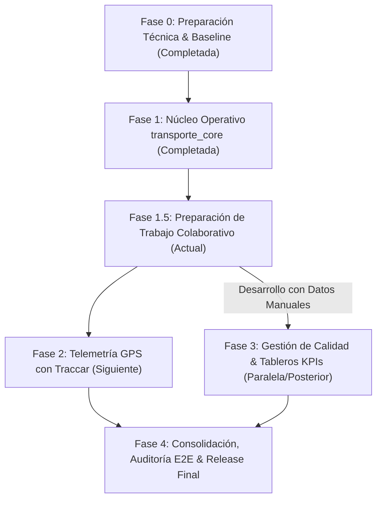

# Plan de Integración Secuencial de Módulos y Funcionalidades
## Sistema de Gestión, Monitoreo y Calidad del Transporte en Buses (SGM-TB)

**Versión del Documento:** 1.0  
**Fecha:** Noviembre 2026  
**Estrategia:** Integración incremental basada en Pull Requests sobre `develop`  

---

## 1. Hoja de Ruta de Integración (Roadmap por Fases)

El desarrollo del sistema SGM-TB sigue una progresión técnica por capas, donde cada fase entrega valor operativo verificable antes de iniciar la siguiente:

---

## 2. Detalle de Fases y Criterios de Integración

### Fase 0 — Preparación Técnica y Baseline *(Completada)*
- **Objetivo:** Asegurar respaldo verificable de la base de datos, inicializar Git con exclusiones estrictas, instalar módulos oficiales `fleet` y `hr` en `transporte_universitario_gc`, y generar el scaffolding de `transporte_core`.
- **Hito de Cierre:** Commit inicial `90b928d` y módulo base `9b21870` en `develop`.

---

### Fase 1 — Núcleo Operativo `transporte_core` *(Completada)*
- **Componentes Entregados:**
  - Paso 1.1: Catálogo de paradas georreferenciadas y rutas con secuencias ordenadas (`10 tests`).
  - Paso 1.2: Extensión de buses de pasajeros y conductores habilitados (`8 tests`).
  - Paso 1.3: Planificación, despacho, prevención de colisiones horarias y ejecución manual (`11 tests`).
  - Paso 1.4: Carga controlada de datos DEMO SGM-TB y suite integral E2E (`6 tests`).
- **Hito de Cierre:** 35 pruebas automatizadas aprobadas (`0 failed, 0 error(s)`), merge commit `42a7fe0` en `develop`.

---

### Fase 1.5 — Preparación de Trabajo Colaborativo *(En Ejecución)*
- **Objetivo:** Establecer la infraestructura documental, procedimental y de control de versiones para que los cuatro integrantes desarrollen en paralelo sin colisiones de código ni de bases de datos.
- **Entregables:**
  - Guía de instalación y aprovisionamiento local (`docs/GUIA_INSTALACION.md`).
  - Guía de flujo Git, branches y PRs (`docs/GUIA_GIT.md`).
  - Matriz de responsabilidades y entregables (`docs/DISTRIBUCION_TRABAJO.md`).
  - Arquitectura desacoplada y ERD (`docs/ARQUITECTURA.md`).
  - Plan de integración secuencial (`docs/PLAN_INTEGRACION.md`).
  - Bitácoras individuales para cada desarrollador (`docs/bitacoras/`).
- **Criterio de Aprobación:** Repositorio limpio y auditado, sin credenciales expuestas, listo para inicializar el repositorio remoto privado `SGM-TB-Transporte`.

---

### Fase 2 — Telemetría GPS con Traccar (`transporte_gps_traccar`) *(Siguiente)*
- **Responsable Principal:** Integrante 3 (con apoyo de Integrante 1).
- **Hitos Secuenciales:**
  1. **Paso 2.1: Infraestructura y Modelos Telemáticos:**
     - Despliegue de Traccar Server en Docker y rediseño de compose.
     - Extensión de `fleet.vehicle` con `traccar_device_id`.
  2. **Paso 2.2: Receptor de Webhook y Autenticación:**
     - Endpoint en Odoo para recepción de posiciones con token Bearer.
     - Validación de formato JSON, descarte de ruido y mitigación de duplicados.
  3. **Paso 2.3: Algoritmo de Geocercas y Arribo Automático:**
     - Cálculo de distancia Haversine frente a `transporte.parada.radio_deteccion`.
     - Registro automático de `transporte.viaje.parada.hora_llegada_real` (`metodo_registro = 'gps'`).
  4. **Paso 2.4: Resiliencia y Pruebas Telemáticas:**
     - Manejo de pérdida temporal de señal GPS y reconexiones.
     - Pruebas unitarias con generador de tramas sintéticas.
- **Criterio de Fusión:** PR desde `feature/gps-traccar` hacia `develop` con suite de tests aprobada y sin alterar la funcionalidad manual de `transporte_core`.

---

### Fase 3 — Calidad de Servicio y Tableros KPIs (`transporte_calidad`)
- **Responsable Principal:** Integrante 4 (con apoyo de Integrante 2).
- **Hitos Secuenciales:**
  1. **Paso 3.1: Modelo de Incidencias Operativas:**
     - Registro de eventos (`transporte.incidencia`), tipificación, severidad y vinculación opcional con viajes y buses.
  2. **Paso 3.2: Motor de Cálculo de Puntualidad (OTP) y Cumplimiento:**
     - Algoritmo de evaluación sobre paradas planificadas vs. reales.
     - Capacidad de calcular métricas exclusivamente con datos manuales de `transporte_core`.
  3. **Paso 3.3: Disponibilidad de Flota y Tasa de Incidencias:**
     - Fórmulas de disponibilidad de parque automotor e incidencias por cada 100 viajes.
     - Tratamiento explícito de viajes cancelados y datos incompletos.
  4. **Paso 3.4: Vistas Ejecutivas y Dashboards:**
     - Tableros gráficos en Odoo Community (vistas Graph y Pivot).
- **Criterio de Fusión:** PR desde `feature/calidad-kpis` hacia `develop` con suite de tests analíticos aprobada.

---

### Fase 4 — Consolidación, Auditoría General y Release Final
- **Responsable Principal:** Integrante 1 (DevOps) con revisión de los 4 integrantes.
- **Actividades:**
  1. Ejecución de pruebas de regresión completas (`core + gps + calidad`).
  2. Validación de rendimiento bajo concurrencia moderada.
  3. Verificación de permisos y perfiles de usuario en entornos limpios.
  4. Fusión de `develop` hacia `main` mediante Pull Request final.
  5. Etiquetado de versión de producción (`v1.0.0`).
  6. Generación del informe técnico final y demostración operativa.

---

## 3. Checklist Obligatorio para Aprobación de Pull Requests (PR)

Antes de autorizar la fusión de cualquier Pull Request hacia `develop`, el Integrante 1 y el Revisor asignado deben verificar:

- [ ] **Sin Dependencias Inversas:** El código no introduce importaciones de módulos superiores en capas inferiores.
- [ ] **Cobertura de Tests:** Todos los nuevos modelos o reglas cuentan con pruebas unitarias en `tests/`.
- [ ] **Ejecución Limpia:** El runner ejecuta todas las pruebas del módulo y de módulos integrados con `0 failed, 0 errors`.
- [ ] **Sin Secretos:** No se incluyen credenciales, tokens ni rutas absolutas locales del host.
- [ ] **Bitácora Actualizada:** El autor actualizó su archivo en `docs/bitacoras/integrante_X.md`.
- [ ] **Idempotencia de Datos:** Si se incorporan datos XML o scripts, son reproducibles y no generan duplicados al reejecutarse.
